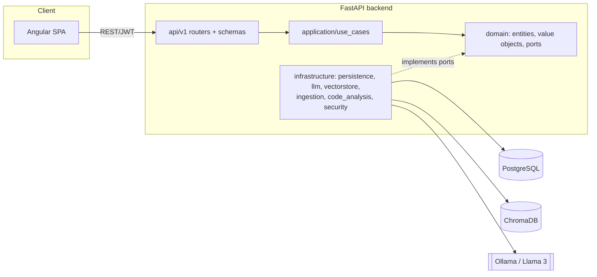

# VulnScan AI

A full-stack platform that analyzes source code and detects security
vulnerabilities using a local LLM (Ollama) grounded by a RAG pipeline over
OWASP Top 10, CWE and MITRE ATT&CK knowledge, stored in ChromaDB.

> Static analysis only — the platform never executes submitted code.

## Architecture

Backend follows Clean/Hexagonal architecture: dependencies point inward
(`api → application → domain`); infrastructure implements domain ports; the
domain layer has zero framework imports (no FastAPI, SQLAlchemy, LangChain,
Chroma).



Full architecture proposal (folder tree, ERD, API endpoint list, `Finding`
schema) is captured in the Phase 0 discussion; this README is filled in
further in Phase 7 with the final diagrams and demo instructions.

## Repository layout

```
backend/    FastAPI + SQLAlchemy 2.0 (async) + Alembic + LangChain/Ollama + Chroma
frontend/   Angular (standalone components, signals, strict TS)
docker-compose.yml   frontend, backend, postgres, chromadb, ollama
```

## Prerequisites

- Docker + Docker Compose
- (for local, non-Docker dev) Python 3.12, Node.js 22, an Angular-CLI-compatible
  npm version

## Quick start (Docker)

```bash
cp .env.example .env
# edit .env - at minimum set JWT_SECRET_KEY and POSTGRES_PASSWORD

docker compose up --build
```

- Backend: http://localhost:8000 (docs at `/docs`, health at `/api/v1/health`)
- Frontend: http://localhost:4200
- ChromaDB: http://localhost:8001
- Ollama: http://localhost:11434

Pull the model Ollama will use once the `ollama` service is up:

```bash
docker compose exec ollama ollama pull llama3
```

## Local development (without Docker)

**Backend**

```bash
cd backend
python -m venv .venv && .venv/Scripts/activate   # .venv/bin/activate on Linux/macOS
pip install -e ".[dev]"
cp ../.env.example ../.env   # or export the vars another way
uvicorn app.main:app --reload
```

`.[dev]` is enough to run the unit tests. Knowledge ingestion and real scans
need the `rag` extra (`.[dev,rag]`), function-level code chunking needs
`chunking` (without it files are cut into plain line windows), and Phase 7
adds `export`. On
Windows, `rag` and `chunking` pull in packages with native extensions
(`chroma-hnswlib`, `tree-sitter-language-pack`) that need the
[Microsoft C++ Build Tools](https://visualstudio.microsoft.com/visual-cpp-build-tools/)
if no prebuilt wheel exists for your Python version — Docker always works
without that, since the Linux image has prebuilt wheels.

**Backend checks**

```bash
ruff check .
black --check .
mypy app
pytest
```

`pytest` never fails for a missing service: tests that need one are skipped,
and the summary says why. What each group needs:

| Tests | Need | How to get it |
| --- | --- | --- |
| Unit | nothing | `pytest` |
| Integration / e2e (database) | PostgreSQL with a `vulnscan_test` database | see below |
| ChromaDB store | the `rag` extra + a ChromaDB server | Docker run below |
| tree-sitter chunker | the `chunking` extra | Docker run below |

To run the database tests from your machine:

```bash
docker compose up -d postgres
docker compose exec postgres createdb -U vulnscan vulnscan_test   # once
export DATABASE_URL=postgresql+asyncpg://vulnscan:<POSTGRES_PASSWORD>@localhost:5432/vulnscan_test
pytest
```

(PowerShell: `$env:DATABASE_URL = "..."`.) If they are still skipped with
`connection was closed in the middle of operation`, port 5432 is already used
by a PostgreSQL installed on your machine: set `POSTGRES_HOST_PORT=5433` in
`.env`, run `docker compose up -d postgres` again, and use port 5433 in
`DATABASE_URL`.

To run **everything**, with nothing skipped, use the dedicated test container.
It runs on Linux, where the `rag` and `chunking` extras install without a
compiler, and it is hard-wired to the `vulnscan_test` database:

```bash
docker compose exec postgres createdb -U vulnscan vulnscan_test   # once
docker compose run --rm backend-tests
```

The first run downloads Chroma's embedding model (about 80 MB) into a Docker
volume; if that download times out, just run the command again.

**Frontend**

```bash
cd frontend
npm ci
npm start          # ng serve
npm run lint
npm run format:check
npm test
```

## Knowledge base

Curated OWASP Top 10 / CWE / MITRE ATT&CK data lives in `backend/data/knowledge/`
and is ingested into ChromaDB (+ a Postgres mirror table for admin listing
and idempotency) via:

```bash
cd backend
pip install -e ".[dev,rag]"
python -m scripts.ingest_knowledge              # all sources
python -m scripts.ingest_knowledge --source cwe # just one
```

Safe to re-run any time — documents are diffed by content hash, so
unchanged entries are skipped rather than re-embedded. The same flow is
available to admins (`is_superuser=true` users) via `POST
/api/v1/knowledge/ingest`, alongside `GET /api/v1/knowledge/documents`,
`GET /api/v1/knowledge/documents/{external_id}` and `GET
/api/v1/knowledge/health`.

## Scanning code

Any authenticated user can submit code and read back their own scans:

| Endpoint | Purpose |
| --- | --- |
| `POST /api/v1/scans` | Submit code (multipart form): either `file` (one source file, or a `.zip` of a project) or `code` (a pasted snippet, with an optional `language`). Returns `202` with the scan in `PENDING`. |
| `GET /api/v1/scans` | Your scans, most recent first (`limit`, `offset`). |
| `GET /api/v1/scans/{id}` | Status and progress - poll this until `COMPLETED` or `FAILED`. |
| `GET /api/v1/scans/{id}/report` | Findings (most severe first), per-severity counts and the scanned files. |
| `DELETE /api/v1/scans/{id}` | Delete a finished scan, its findings and its stored source. |
| `GET /api/v1/dashboard/summary` | Your totals: scans by status, findings by severity, most frequent CWEs, latest scans. |

```bash
curl -X POST http://localhost:8000/api/v1/scans   -H "Authorization: Bearer $TOKEN" -F "file=@project.zip"
```

What happens to a submission:

1. **Intake.** The upload is size-checked and decoded as text. Archives are
   extracted in memory with zip-slip and zip-bomb protection (entry count,
   uncompressed size and compression ratio are capped, and enforced on the
   bytes actually decompressed rather than on what the headers claim).
   Stored files are named after generated ids - no client-supplied name or
   archive path is ever used as a filesystem path.
2. **Chunking.** Each file is cut at function/class boundaries with
   tree-sitter (Python, JavaScript, TypeScript/TSX, Java, Go, PHP, C#, Ruby),
   keeping module-level code too; other files are cut into line windows.
3. **Retrieval + analysis.** For each chunk, the most relevant OWASP / CWE /
   ATT&CK entries are retrieved from ChromaDB and given to the LLM together
   with the line-numbered code. The reply must be a JSON object matching a
   strict schema; an invalid reply is sent back with the reason and retried.
4. **Validation.** Nothing the LLM says is stored unchecked: a CWE / OWASP /
   ATT&CK id is kept only if it exists in the ingested knowledge base (its
   title and URL then come from there, not from the LLM), line numbers are
   forced inside the chunk that was reviewed, and the vulnerable snippet is
   cut from the stored source rather than echoed by the model.

Scans run as background jobs inside the backend process, one at a time by
default (`SCAN_MAX_CONCURRENT_JOBS`), since they all share one local model.
A scan interrupted by a restart is marked `FAILED` at the next startup -
this assumes a single backend process, as in `docker-compose.yml`.

Ingest the knowledge base before scanning: without it scans still run, but
findings carry no CWE / OWASP / ATT&CK classification.

## Frontend

Angular (standalone components, signals, zoneless), in `frontend/src/app`:

```
core/      API base URL, error messages, and everything auth: service,
           HTTP interceptor, route guards, token storage
features/  one folder per page (login, register, dashboard, ...)
layout/    the shell around signed-in pages (header, navigation)
shared/    small presentational components
```

How a session works:

- **Tokens.** The access token is kept in memory only. The refresh token is
  kept in `sessionStorage`, so a reload restores the session but closing the
  tab ends it, and each tab has its own token - the backend revokes every
  session of a user when a refresh token is reused, which two tabs sharing
  one token would trigger.
- **Requests.** An interceptor adds the access token to calls to our API
  (and to nothing else). On a 401 it refreshes the token once - a single
  refresh shared by all requests failing at that moment - and replays the
  request; if the refresh is refused, the user is returned to the login page.
- **Routes.** Guards send visitors to `/login` (remembering where they were
  going) and keep signed-in users off the login and register pages. They are
  a navigation aid: the backend authorizes every request itself.

Pages, all behind sign-in:

| Page | Address | What it does |
| --- | --- | --- |
| Dashboard | `/dashboard` | Totals, findings by severity, most frequent weaknesses, latest scans. |
| New scan | `/scans/new` | Paste a snippet, or upload a source file or a `.zip` of a project. |
| Scans | `/scans` | Every scan you submitted, paginated, with delete. |
| Scan report | `/scans/{id}` | Progress while the scan runs, then its findings, filterable by severity. |

A page showing a scan that is still running re-reads it every 3 seconds, and
stops once it has finished. Reports are text the model wrote about code a
user submitted, so everything in them is rendered as plain text, never as
HTML, and a reference is only turned into a link when its URL is http(s).

In development (`npm start`) the browser calls the backend directly at
`http://localhost:8000/api/v1` (`src/environments/environment.ts`). The
production bundle calls `/api/v1` on its own origin and nginx proxies it to
the backend (`frontend/nginx.conf`).

## Project status

Built phase by phase; each phase is reviewed before the next starts.

- [x] Phase 0 — Architecture proposal (folder tree, ERD, API list, `Finding` schema)
- [x] Phase 1 — Project setup (docker-compose, config, logging, linting, pre-commit, CI)
- [x] Phase 2 — Backend auth (domain → use cases → infra → API) + tests
- [x] Phase 3 — Knowledge ingestion (OWASP, CWE, ATT&CK) into ChromaDB + retrieval tests
- [x] Phase 4 — Code chunking + LLM analysis pipeline + scan use cases + async jobs + tests
- [x] Phase 5 — Angular core (auth, interceptors, guards, layout)
- [x] Phase 6 — Angular features (new scan, scan list, report view, dashboard)
- [ ] Phase 7 — Report export, error handling polish, security hardening, README, demo data
