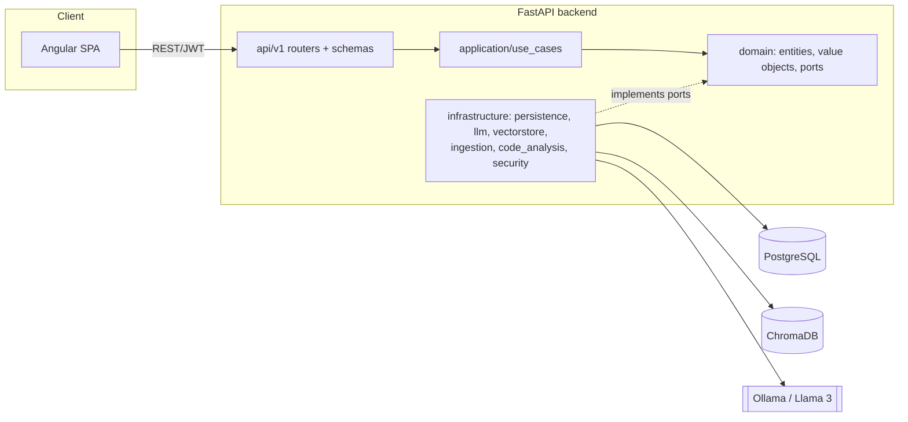

# VulnScan AI

A full-stack platform that analyzes source code and detects security
vulnerabilities using a local LLM (Ollama) grounded by a RAG pipeline over
OWASP Top 10, CWE and MITRE ATT&CK knowledge, stored in ChromaDB.

> Static analysis only — the platform never executes submitted code.

## Architecture

Backend follows Clean/Hexagonal architecture: dependencies point inward
(`api → application → domain`); infrastructure implements domain ports; the
domain layer has zero framework imports (no FastAPI, SQLAlchemy, LangChain,
Chroma).



Full architecture proposal (folder tree, ERD, API endpoint list, `Finding`
schema) is captured in the Phase 0 discussion; this README is filled in
further in Phase 7 with the final diagrams and demo instructions.

## Repository layout

```
backend/    FastAPI + SQLAlchemy 2.0 (async) + Alembic + LangChain/Ollama + Chroma
frontend/   Angular (standalone components, signals, strict TS)
docker-compose.yml   frontend, backend, postgres, chromadb, ollama
```

## Prerequisites

- Docker + Docker Compose
- (for local, non-Docker dev) Python 3.12, Node.js 22, an Angular-CLI-compatible
  npm version

## Quick start (Docker)

```bash
cp .env.example .env
# edit .env - at minimum set JWT_SECRET_KEY and POSTGRES_PASSWORD

docker compose up --build
```

- Backend: http://localhost:8000 (docs at `/docs`, health at `/api/v1/health`)
- Frontend: http://localhost:4200
- ChromaDB: http://localhost:8001
- Ollama: http://localhost:11434

Pull the model Ollama will use once the `ollama` service is up:

```bash
docker compose exec ollama ollama pull llama3
```

## Local development (without Docker)

**Backend**

```bash
cd backend
python -m venv .venv && .venv/Scripts/activate   # .venv/bin/activate on Linux/macOS
pip install -e ".[dev]"
cp ../.env.example ../.env   # or export the vars another way
uvicorn app.main:app --reload
```

`.[dev]` is enough through Phase 2. From Phase 3 you'll also need the `rag`
extra (`.[dev,rag]`), Phase 4 adds `chunking`, and Phase 7 adds `export`. On
Windows, `rag` and `chunking` pull in packages with native extensions
(`chroma-hnswlib`, `tree-sitter-language-pack`) that need the
[Microsoft C++ Build Tools](https://visualstudio.microsoft.com/visual-cpp-build-tools/)
if no prebuilt wheel exists for your Python version — Docker always works
without that, since the Linux image has prebuilt wheels.

**Backend checks**

```bash
ruff check .
black --check .
mypy app
pytest
```

**Frontend**

```bash
cd frontend
npm ci
npm start          # ng serve
npm run lint
npm run format:check
npm test
```

## Knowledge base

Curated OWASP Top 10 / CWE / MITRE ATT&CK data lives in `backend/data/knowledge/`
and is ingested into ChromaDB (+ a Postgres mirror table for admin listing
and idempotency) via:

```bash
cd backend
pip install -e ".[dev,rag]"
python -m scripts.ingest_knowledge              # all sources
python -m scripts.ingest_knowledge --source cwe # just one
```

Safe to re-run any time — documents are diffed by content hash, so
unchanged entries are skipped rather than re-embedded. The same flow is
available to admins (`is_superuser=true` users) via `POST
/api/v1/knowledge/ingest`, alongside `GET /api/v1/knowledge/documents`,
`GET /api/v1/knowledge/documents/{external_id}` and `GET
/api/v1/knowledge/health`.

## Project status

Built phase by phase; each phase is reviewed before the next starts.

- [x] Phase 0 — Architecture proposal (folder tree, ERD, API list, `Finding` schema)
- [x] Phase 1 — Project setup (docker-compose, config, logging, linting, pre-commit, CI)
- [x] Phase 2 — Backend auth (domain → use cases → infra → API) + tests
- [x] Phase 3 — Knowledge ingestion (OWASP, CWE, ATT&CK) into ChromaDB + retrieval tests
- [ ] Phase 4 — Code chunking + LLM analysis pipeline + scan use cases + async jobs + tests
- [ ] Phase 5 — Angular core (auth, interceptors, guards, layout)
- [ ] Phase 6 — Angular features (new scan, scan list, report view, dashboard)
- [ ] Phase 7 — Report export, error handling polish, security hardening, README, demo data
